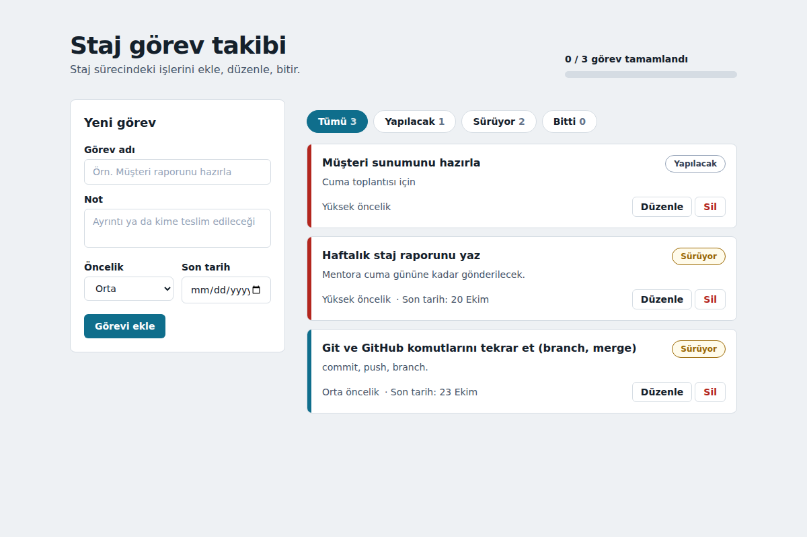

# Staj Görev Takibi

Staj sürecindeki görevleri **ekleyip, listeleyip, güncelleyip, silebildiğin** React uygulaması. Veriler tarayıcının **LocalStorage** alanında saklanır, sayfa yenilense de kaybolmaz.



**Canlı demo:** [NETLIFY BAĞLANTISINI BURAYA EKLE]

## Özellikler

| İşlem | Nasıl çalışır |
|---|---|
| **Ekle** | Soldaki formdan görev adı, not, öncelik ve son tarih girilir. Görev adı en az 3 karakter olmalıdır. |
| **Listele** | Görevler kartlar halinde listelenir. Üstteki filtrelerle Tümü / Yapılacak / Sürüyor / Bitti görülebilir. |
| **Güncelle** | "Düzenle" ile görev yerinde düzenlenir. Durum etiketine tıklayınca Yapılacak → Sürüyor → Bitti sırasıyla değişir. |
| **Sil** | "Sil" ikinci bir onay ister ("Evet, sil"), yanlışlıkla silmeyi önler. |

Ek olarak: tamamlanma çubuğu, süresi geçen görevlerin vurgulanması, mobil uyumlu tasarım, klavye ile kullanım ve ekran okuyucu etiketleri.

## Kullanılan teknolojiler

- **React 18** + **TypeScript** (Vite ile)
- **Tailwind CSS 3** (stil)
- **LocalStorage** (kalıcı veri, `useLocalStorage` hook'u)
- Netlify (yayın)

## Dosya yapısı

```
src/
├── components/    TaskForm, TaskItem, TaskList, FilterBar, Progress
├── pages/         TasksPage (ana sayfa, ekle/güncelle/sil mantığı burada)
├── interfaces/    Task.ts (Task, TaskDraft, Status, Priority tipleri)
├── hooks/         useLocalStorage.ts
└── utils/         labels.ts (Türkçe etiketler, tarih yardımcıları)
```

## Çalıştırma

```bash
npm install
npm run dev       # http://localhost:5173
npm run build     # üretim derlemesi: dist/
```
Node.js 18 veya üzeri gerekir.

## Netlify'a yayınlama

1. Projeyi GitHub'a yükle (public depo).
2. [netlify.com](https://www.netlify.com) → **Add new site → Import an existing project** → GitHub'ı seç → depoyu seç.
3. Build ayarları `netlify.toml` dosyasından otomatik okunur (`npm run build`, klasör `dist`). **Deploy** de.
4. Oluşan adresi bu dosyadaki "Canlı demo" satırına ve teslim formuna ekle.
